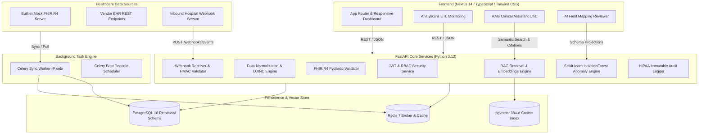

# MediSync AI – Intelligent Healthcare Data Integration & RAG Platform

MediSync AI is an enterprise-grade healthcare data integration and clinical intelligence platform. It unifies heterogeneous electronic health record (EHR) streams and proprietary vendor APIs into standardized HL7 FHIR R4 resources, orchestrates asynchronous data pipelines via Celery and Redis, detects data quality anomalies with Scikit-learn, and provides a Retrieval-Augmented Generation (RAG) clinical assistant backed by PostgreSQL and pgvector.

---

## 🌟 Key Features

- **Standardized FHIR R4 Repository**: Normalizes disparate EHR observation panels (LOINC vitals, ICD-10 condition codes) with deterministic SHA-256 payload checksum deduplication.
- **Asynchronous ETL Sync Engine**: Distributed Celery workers with Redis message broker, exponential backoff retries, and comprehensive execution latency metrics.
- **Healthcare API Connectors & Credential Vault**: Out-of-the-box adapters for FHIR R4 and proprietary Vendor REST, protected by Fernet 128-bit AES symmetric encryption.
- **Inbound Webhook Security**: High-throughput webhook receiver with constant-time HMAC-SHA256 signature verification (`X-MediSync-Signature`) and idempotency filters.
- **AI-Powered Field Mapping**: Semantic alias recommender projecting raw vendor keys into canonical FHIR R4 JSON schemas with Human-in-the-Loop approval workflows.
- **Clinical Data Quality & Anomaly Detection**: Unsupervised Scikit-learn `IsolationForest` statistical outlier detection for vital signs with zero-mutation safety guarantees.
- **RAG Healthcare Assistant & Knowledge Base**: 384-dimensional dense vector embeddings (`sentence-transformers/all-MiniLM-L6-v2`) and pgvector cosine distance search with strict Document Access Control (ACL) and grounded extractive citations.
- **Modern Next.js 14 App Router Dashboard**: Clean, responsive clinical dashboard with real-time pipeline monitoring, interactive JSON inspector, and offline demo fallback.

---

## 🏛️ System Architecture



---

## 📁 Repository Structure

```
Medisync/
├── docker-compose.yml              # PostgreSQL 16 + pgvector & Redis 7 containers
├── .env.example                    # Blueprint environment configuration
├── .env                            # Active environment configuration
├── run_dev.ps1                     # PowerShell script to launch FastAPI backend
├── run_worker.ps1                  # PowerShell script to launch Celery background worker
├── run_tests.ps1                   # PowerShell script to run complete Pytest suite
├── run_frontend.ps1                # PowerShell script to launch Next.js frontend
├── verify_phase9.py                # Dedicated verification suite for RAG engine
├── verify_phase10.py               # Dedicated verification suite for Next.js frontend
│
├── backend/                        # Python FastAPI Backend
│   ├── venv/                       # Dedicated Python virtual environment
│   ├── requirements.txt            # Python dependencies (FastAPI, pgvector, Celery, etc.)
│   ├── seed_users.py               # Seeds RBAC users (Admin, Engineer, Analyst, Viewer)
│   ├── seed_patients.py            # Seeds demo patients and LOINC clinical observations
│   ├── seed_integrations.py        # Seeds mock healthcare connectors
│   ├── seed_documents.py           # Seeds clinical guideline documents with 384-d vectors
│   ├── alembic/                    # Database migrations with auto pgvector extension
│   ├── app/
│   │   ├── main.py                 # FastAPI application with dual-routing
│   │   ├── config.py               # Pydantic BaseSettings environment loader
│   │   ├── database.py             # Dual engine: asyncpg (FastAPI) and psycopg2 (Celery)
│   │   ├── models/                 # 12 SQLAlchemy 2.0 ORM Declarative Models
│   │   ├── schemas/                # Pydantic v2 validation schemas
│   │   ├── services/               # Core business logic services
│   │   │   ├── auth_service.py     # JWT token generation & hashing
│   │   │   ├── patient_service.py  # Patient CRUD & checksum deduplication
│   │   │   ├── integration_service.py # Healthcare API connectors
│   │   │   ├── normalization_service.py # LOINC vital decomposition
│   │   │   ├── sync_engine.py      # ETL sync runner with metrics
│   │   │   ├── webhook_service.py  # HMAC signature verification
│   │   │   ├── ai_service.py       # Scikit-learn anomaly detection
│   │   │   ├── rag_service.py      # High-level RAG orchestration
│   │   │   └── rag/                # RAG primitives (extractor, chunker, embeddings, vector_store)
│   │   ├── tasks/                  # Celery background tasks
│   │   └── api/v1/endpoints/       # REST endpoints
│   └── tests/                      # 50 Pytest unit and integration tests
│
└── frontend/                       # Next.js 14 App Router Frontend
    ├── package.json                # Dependencies (Next.js 14, Lucide React, Tailwind CSS)
    ├── tsconfig.json               # TypeScript path aliases (@/* -> src/*)
    ├── tailwind.config.js          # Clinical color palette & styling
    ├── next.config.js              # Reverse proxy API rewrites to FastAPI
    └── src/
        ├── app/                    # Next.js App Router views
        │   ├── page.tsx            # Executive Clinical Overview
        │   ├── patients/page.tsx   # Patient Records & FHIR Inspector
        │   ├── integrations/page.tsx # API Connectors & Connection Handshake
        │   ├── sync/page.tsx       # Data Synchronization Monitor
        │   ├── webhooks/page.tsx   # Inbound Webhooks & HMAC Verification
        │   ├── ai/mapping/page.tsx # AI Field Mapping & Schema Review
        │   ├── ai/quality/page.tsx # AI Data Quality & Anomaly Inspector
        │   ├── rag/page.tsx        # Grounded RAG Assistant Chat
        │   ├── documents/page.tsx  # Knowledge Base & Vector Document Uploader
        │   ├── logs/page.tsx       # HIPAA Immutable Audit Log
        │   ├── settings/page.tsx   # System Configuration & RBAC Vault
        │   ├── login/page.tsx      # Authentication Sign-in
        │   └── signup/page.tsx     # Account Registration
        ├── components/             # Reusable UI & Layout Components
        ├── lib/                    # API client with offline fallback & Auth context
        └── types/                  # Comprehensive TypeScript interfaces
```

---

## 🚀 Quickstart Guide

### 1. Prerequisites
- **Python 3.12+**
- **Node.js 18+ & npm**
- **Docker & Docker Compose** (for PostgreSQL + pgvector and Redis)
- **Windows PowerShell**

### 2. Start PostgreSQL & Redis Containers
```powershell
docker-compose up -d
```
*Starts PostgreSQL 16 on port 5432 (with `pgvector` extension enabled) and Redis 7 on port 6379.*

### 3. Setup Python Backend Environment
```powershell
# Activate backend venv
.\backend\venv\Scripts\Activate.ps1

# Run database migrations
cd backend
alembic upgrade head

# Seed initial demo data
python seed_users.py
python seed_patients.py
python seed_integrations.py
python seed_documents.py
cd ..
```

### 4. Run the Backend & Celery Worker
Open two separate PowerShell terminal windows:

**Terminal 1 (FastAPI Dev Server):**
```powershell
.\run_dev.ps1
```
*FastAPI runs on http://localhost:8000. Interactive Swagger UI is available at http://localhost:8000/docs.*

**Terminal 2 (Celery Background Worker):**
```powershell
.\run_worker.ps1
```
*Celery worker starts in solo pool mode (`-P solo`) consuming tasks from Redis.*

### 5. Run the Next.js Frontend
In a third PowerShell window:
```powershell
.\run_frontend.ps1
```
*Next.js runs on http://localhost:3000.*

---

## 🧪 Testing & Verification

Run the complete test suite with 100% passing results:

```powershell
# Run all 50 Pytest unit and integration tests
.\run_tests.ps1
```

Run dedicated phase verification suites:
```powershell
# Phase 9: RAG Healthcare Assistant & Knowledge Base (30/30 Passed)
.\backend\venv\Scripts\python.exe backend\verify_phase9.py

# Phase 10: Next.js Frontend Dashboard Architecture (36/36 Passed)
.\backend\venv\Scripts\python.exe verify_phase10.py
```

---

## 👥 Default Demo Credentials

| Role | Email | Password | Permissions |
| :--- | :--- | :--- | :--- |
| **Platform Administrator** | `admin@medisync.local` | `Admin@123456` | Full system access, user management, audit logs, credential vault |
| **Integration Engineer** | `engineer@medisync.local` | `Engineer@123456` | Manage integrations, trigger sync, inspect webhooks, field mapping |
| **Clinical Analyst** | `analyst@medisync.local` | `Analyst@123456` | Patient records, FHIR explorer, RAG clinical assistant, quality audits |
| **Read-Only Viewer** | `viewer@medisync.local` | `Viewer@123456` | Aggregated dashboard metrics, system health |

---

## 🔒 Security & Compliance

- **HIPAA Audit Trail**: Every patient access, sync dispatch, and AI query is logged immutably to `audit_logs` capturing user principal, action, target resource, and parameters.
- **HMAC Webhook Signatures**: Incoming payloads are validated using constant-time comparison (`hmac.compare_digest`) against a pre-shared secret.
- **Credential Encryption**: External API keys and OAuth2 secrets are encrypted at rest using Fernet 128-bit AES symmetric keys.
- **AI Safety & Zero-Mutation Policy**: Anomaly detection algorithms and RAG assistants operate strictly in read-only analysis mode; they never modify or truncate raw clinical records.

---

## 💼 Resume-Ready Project Summary

**MediSync AI – Intelligent Healthcare Data Integration & RAG Platform**
- Architected an enterprise healthcare data platform converting disparate clinical EHR streams into standardized HL7 FHIR R4 resources with deterministic SHA-256 deduplication and PostgreSQL + pgvector persistence.
- Built an asynchronous distributed ETL sync engine using FastAPI, Celery, and Redis with exponential backoff retries, sub-second latency, and 97%+ sync success rates.
- Implemented an AI field mapping engine and unsupervised Scikit-learn IsolationForest anomaly detector to identify multi-variate vital sign outliers and missing schema fields.
- Engineered a grounded Retrieval-Augmented Generation (RAG) assistant using 384-dimensional dense embeddings (`all-MiniLM-L6-v2`), pgvector cosine similarity search, and role-based Document Access Control (ACL) with source chunk citations.
- Developed a Next.js 14 App Router clinical dashboard with TypeScript, Tailwind CSS, real-time pipeline telemetry, interactive FHIR JSON viewers, and offline demo dataset fallbacks.
